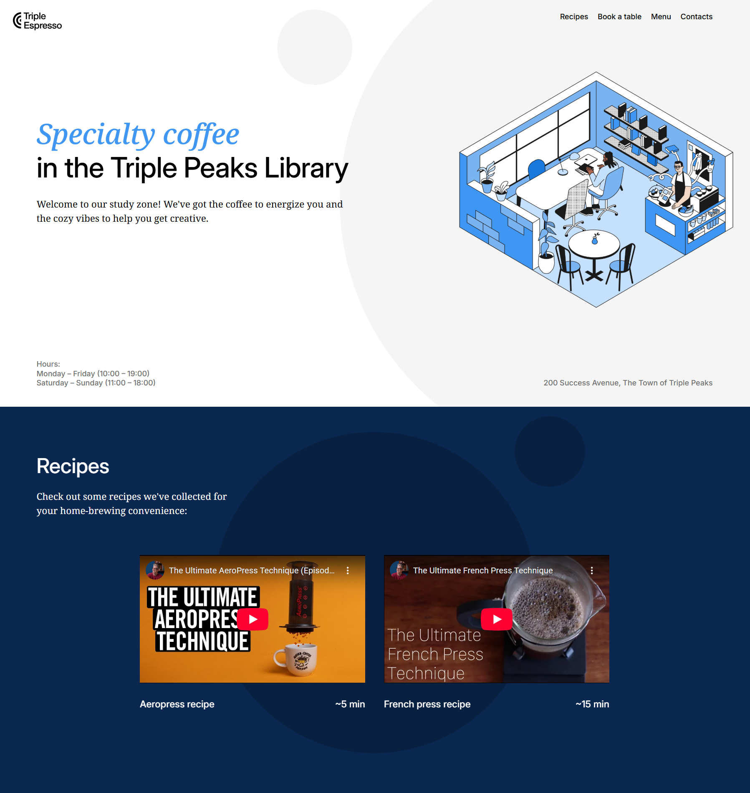
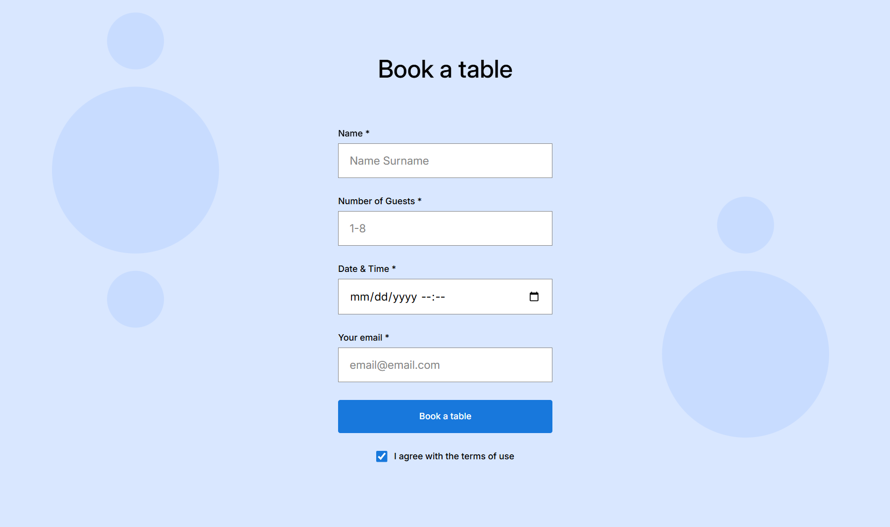
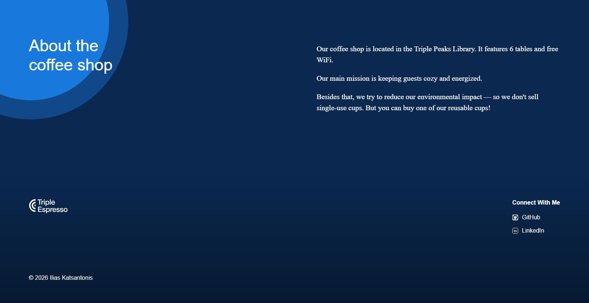

Coffee Shop - React

A coffee shop website originally built with HTML, CSS, and vanilla JavaScript, then converted to React with a component-based structure and React form validation.

## Sections

- **Header / Navigation**
  Navigation links connect to the different sections of the page.

- **Recipes**
  Displays coffee recipes and embedded recipe videos.

- **Reservation Form**
  A controlled React form with state-based validation, error messages, checkbox validation, and form reset after successful submission.

- **Menu**
  Displays the café menu using structured cards and BEM classes.

- **About**
  Information about the coffee shop with animated decorative elements.

- **Footer**
  Contains the café branding and links to my GitHub and LinkedIn profiles.

## Technologies and Features

- React
- Vite
- Component-based architecture
- React state management
- Controlled form inputs
- Form validation and error handling
- Conditional form submission
- Semantic HTML5
- BEM methodology
- Flexbox
- CSS animations and transforms
- Component-specific CSS

## Project Preview

### Homepage & Recipes

### Reservation Form

### Menu & Footer

## Live Demo

[View Coffee Shop Website](https://iliascka.github.io/coffee-shop-website/)
